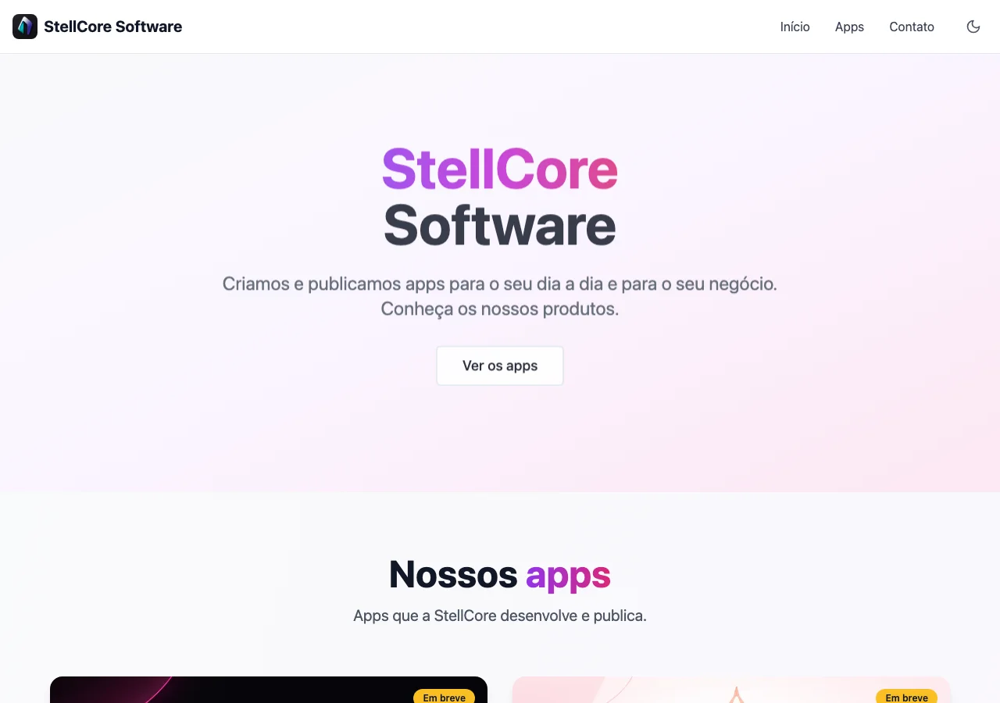
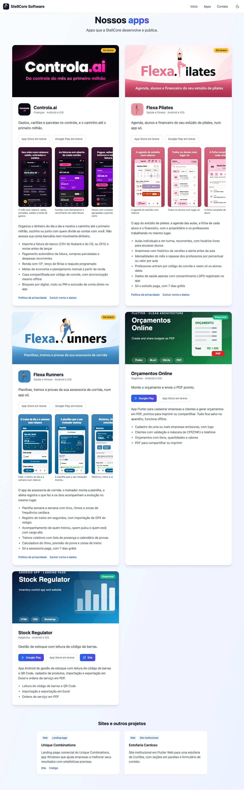

# StellCore Software

Site da StellCore: portfólio dos apps que a empresa desenvolve e publica (Android e iOS), com contato.

**Site:** https://bruno-dall.github.io/stellcore-software/





## O que tem no site

- Um bloco por app, com capa, ícone, selo "Disponível" ou "Em breve", botões das lojas, vídeo com transcrição (opcional), galeria de screenshots com legendas, descrição e links de privacidade.
- Seção de sites e outros projetos.
- Contato.
- Versão em português e inglês, com botão de idioma ao lado do de tema (a escolha fica salva no navegador).

## Adicionar ou editar um app

Os apps ficam em [src/data/apps.ts](src/data/apps.ts) e os textos do site em [src/i18n.tsx](src/i18n.tsx), sempre em português e inglês. Cada app tem nome, categoria, status, links das lojas (`playStore`, `appStore`), screenshots, descrição e bullets. As imagens ficam em `src/images/apps/<app>/`.

## Rodando

```bash
npm ci
npm run dev      # http://localhost:5173
npm run build    # gera dist/
```

## Deploy

Todo push na `main` publica no GitHub Pages pelo workflow [deploy.yml](.github/workflows/deploy.yml). A versão anterior do site está na branch `legacy/versao-atual`.

## Stack

Vite, React, TypeScript, Tailwind CSS e shadcn/ui.
